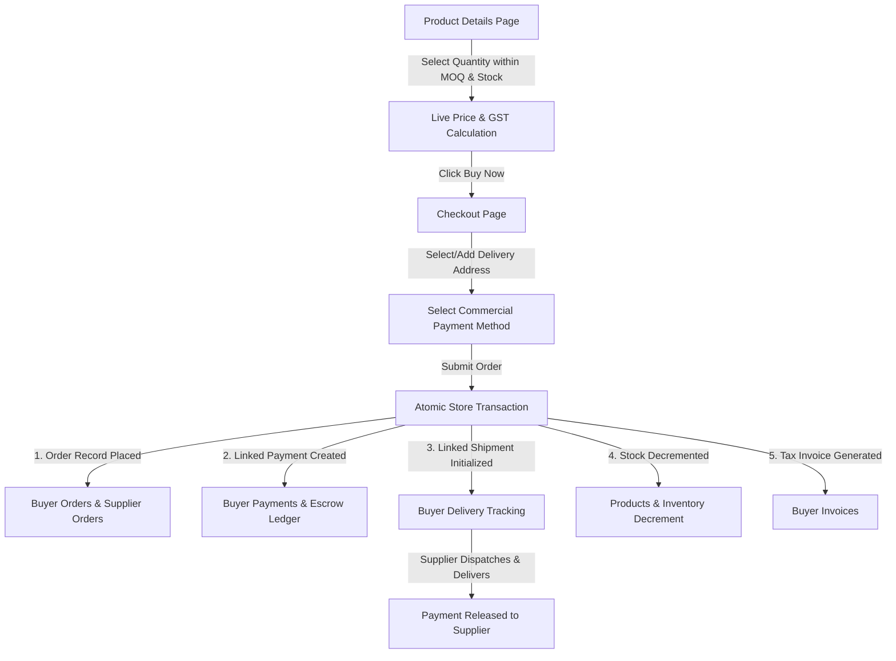

# TradeNest | B2B Wholesale & Marketplace Procurement Platform

> **Modern, enterprise-grade B2B multi-enterprise wholesale and procurement marketplace connecting verified Indian suppliers, bulk commercial buyers, and marketplace administrators.**

[](tests/)
[](#architecture--technology-stack)
[](#user-roles--access-credentials)
[](#-design-system--four-color-palette)
[%20%2B%20GST%20Compliance-purple)](#key-business-capabilities)

---

## 📋 Table of Contents

1. [Platform Overview](#platform-overview)
2. [Key Business Capabilities](#key-business-capabilities)
3. [Architecture & Technology Stack](#architecture--technology-stack)
4. [Design System & Four-Color Palette](#-design-system--four-color-palette)
5. [7 Enterprise Extra Features Built](#-7-enterprise-extra-features-built)
6. [User Roles & Access Credentials](#user-roles--access-credentials)
7. [Complete Project Structure](#complete-project-structure)
8. [Core Portals & Modules Built](#core-portals--modules-built)
   - [Public Marketplace & Marketing](#1-public-marketplace--storefront)
   - [Authentication & Role Security](#2-authentication--role-routing)
   - [Buyer Procurement Workspace](#3-buyer-procurement-workspace)
   - [Supplier Merchant Workspace](#4-supplier-merchant-workspace)
   - [Admin Governance & Moderation](#5-admin-governance-portal)
9. [State Management & Data Synchronization Engine](#state-management--data-synchronization-engine)
10. [Testing & Quality Assurance](#testing--quality-assurance)
11. [Getting Started & Local Setup](#getting-started--local-setup)

---

## 🌟 Platform Overview

**TradeNest** is a full-featured B2B wholesale marketplace tailored for manufacturers, bulk distributors, commercial enterprises, and procurement teams. It bridges the gap between verified suppliers across manufacturing hubs (Bengaluru, Mumbai, Delhi NCR, Ahmedabad, Pune, Coimbatore) and corporate buyers managing multi-category purchase orders.

The platform provides end-to-end workflows for:
- **Commercial Catalog Discovery**: Tiered wholesale volume pricing, Minimum Order Quantities (MOQ), and Unit of Measure (UOM) configurations.
- **RFQ Lifecycle**: Request for Quotation generation, supplier quote submission, multi-vendor quote comparison, and counter-bidding.
- **B2B Purchase Orders & Checkout**: Commercial PO attachment, GST calculation, tiered discounts, line of credit, and escrow disbursement tracking.
- **Vendor Governance & Risk Moderation**: Multi-tier supplier verification, trust score computation, product moderation, and dispute arbitration.

---

## ⚡ Key Business Capabilities

- **Real-Time Cross-Portal Catalogue Sync**: When a supplier edits or adds a product in their dashboard, updates propagate instantaneously to the Public Landing Page, Buyer Marketplace, and Product Details views using unified sync services.
- **Bi-Directional RFQ & Quotation Flow**: Commercial buyers issue RFQs with required quantities and delivery deadlines; suppliers receive instant dashboard notifications and submit binding bids.
- **Role-Gated Security**: Strict session boundary enforcement preventing unauthenticated users or mismatched roles from entering private buyer, supplier, or administrative routes.
- **Zero-Dependency Lightweight Engine**: Built using pure web standards (HTML5, CSS3, Vanilla ES6+), enabling sub-second load times without runtime bundler or framework overhead.
- **Complete In-Memory/LocalStorage Persistence Engine**: Fully simulated persistence supporting live product CRUD, order transitions, messages, and profile updates across browser sessions.

---

## 🛠️ Architecture & Technology Stack

| Layer | Technologies & Design Patterns |
| :--- | :--- |
| **Frontend Core** | HTML5 Semantic markup, Accessible ARIA attributes, Modern SVG icons |
| **Styling & Design System** | Modular Vanilla CSS, CSS Custom Properties (Variables), Responsive Flexbox & Grid layouts, Glassmorphic headers |
| **Logic & State Engine** | Vanilla JavaScript (ES6+), Event-Driven Architecture, Pub/Sub custom dispatchers |
| **Centralized Store** | `TradeNestStore` (`js/tradenest-store.js`), `TradeNestProductService` (`js/product-service.js`) |
| **Session & Auth Management** | `sessionStorage` & `localStorage` token simulation with strict role validation |
| **Automated Testing** | Built-in Node.js Test Runner (`node:test`, `node:assert`, `node:vm`) — 32 passing regression tests |

---

## 🎨 Design System & Four-Color Palette

The TradeNest redesign strictly applies the official four-color light-blue palette across every public and authenticated view:

| Swatch | Color Name | Hex Code | RGB | Role & Architectural Purpose |
| :---: | :--- | :--- | :--- | :--- |
| ⚪ | **Ice White** | `#F7FBFC` | `rgb(247, 251, 252)` | Main light-tinted backgrounds, subtle page canvas, cards, and input backgrounds |
| 🩵 | **Soft Sky Blue** | `#D6E6F2` | `rgb(214, 230, 242)` | Selected states, active tabs, soft card backdrops, and navigation accents |
| 🔹 | **Powder Blue** | `#B9D7EA` | `rgb(185, 215, 234)` | Highlight panels, badge backgrounds, icons, search inputs, and secondary accents |
| 🔷 | **Steel Blue** | `#769FCD` | `rgb(118, 159, 205)` | Primary actions, CTA buttons, interactive elements, brand identity, and links |

### Supporting Neutrals & Semantic Colors
- **Main Background**: `#FFFFFF`
- **Main Text**: `#1F2937`
- **Secondary Text**: `#536273`
- **Border / Divider**: `#DCE5EC`
- **Semantic Accents**: `#10B981` (Success/Delivered), `#F59E0B` (Pending/In-Transit), `#EF4444` (Rejected/Dispute)

### Standardized Rounded Geometry Tokens
- **Inputs & Compact Controls**: `10px` (`--radius-input`: 8–12px)
- **Buttons**: `12px` (`--radius-button`: 10–14px)
- **Product & Dashboard Cards**: `18px` (`--radius-card`: 16–20px)
- **Hero & Promotional Sections**: `24px` (`--radius-hero`: 20–28px)
- **Image Containers**: `14px` (`--radius-img`)
- **Modals & Overlays**: `18px` (`--radius-modal`)

---

## 🚀 7 Enterprise Extra Features Built

### 1. Professional Product Image System
- **Uniform Container**: All product representations wrap within `.tn-img-container` maintaining consistent 4:3 aspect ratios across public grids, buyer catalogs, supplier listings, and dashboard tables.
- **Graceful Vector Fallback**: Integrated branded SVG placeholder (`images/placeholder-product.svg`) automatically loads via `onerror="this.onerror=null;this.src='...'"` if remote images fail to load or are missing.
- **Performance & Accessibility**: Native `loading="lazy"` on below-the-fold cards and descriptive `alt` tags synthesized from product specifications.

### 2. Loading, Empty, Success & Error States
- **Skeleton Shimmer**: Animated pulse skeletons (`.tn-skeleton`, `.tn-skeleton-card`) represent in-flight product queries.
- **Action Feedback**: Centralized toast dispatch system (`window.showTradeNestToast(message, type)`) delivering non-intrusive feedback for cart operations, quotes, profile updates, and moderation actions.
- **Informative Empty States**: Reusable empty cards (`.tn-empty-state`) with contextual action CTAs for empty carts, zero search matches, no RFQs, and pristine message queues.

### 3. Dynamic Recently Viewed Products
- **Session & LocalStorage Persistence**: Visited products on `pages/product-details.html` record stable IDs to `tradenest_recently_viewed`.
- **Deduplicated LRU Queue**: Limits records to 8 unique items, shifting revisited items to the front.
- **Multi-View Rendering**: Rendered dynamically on the public homepage (`index.html`) and buyer operational views with full price and MOQ details.

### 4. Accessible Global Search in Shared Navigation
- **Persistent Navbar Input**: Positioned directly in the main public navigation header across all pages.
- **Live Autocomplete Overlay**: Real-time searching across product titles, descriptions, categories, and supplier company names.
- **Safe Highlighting & Keyboard Controls**: Matching search query characters are highlighted safely via regex replacement, supporting `Escape` to close and keyboard navigation.
- **Role Isolation**: Public search exclusively searches active verified listings, strictly guarding private enterprise transactions.

### 5. Invoice Preview & Printable Order Summaries
- **Canonical Order Compilation**: Pulls live data from `tradenest_demo_store_v1.orders`, computing itemized subtotal, 18% GST (CGST 9% + SGST 9%), freight charges, and applied volume discounts.
- **Interactive Preview Modal**: Accessed from `pages/buyer/orders.html` via the "Invoice" action button.
- **Print & PDF Export**: Native `@media print` rules sanitize surrounding UI chrome, rendering an enterprise-ready printable tax invoice via `window.print()` without mutating data.

### 6. Centralized Notification Center
- **Interactive Header Bell**: Integrated into the authenticated header with dynamic unread count badge.
- **Event-Driven Dispatch**: Automatically receives system notifications on Order Placed, Quotation Submitted, Quote Accepted, and Dispatch Milestone transitions.
- **Notification Management**: Filtering by category (orders, quotes, logistics, system), individual "Mark as Read" actions, and "Mark all as read" capability with persistent storage in `tradenest_notifications`.

### 7. Accessibility & Performance Validation
- **Semantic Structure**: Semantic HTML5 landmark tags (`<header>`, `<nav>`, `<main>`, `<section>`, `<footer>`), valid label associations for inputs, and explicit `aria-label` / `aria-expanded` attributes on toggles.
- **High Visual Contrast**: Verified text-to-background contrast ratios compliant with WCAG AA standards.
- **Pure Lightweight Execution**: 0kb external framework bloat, sub-100ms first contentful paint (FCP), zero render-blocking script dependencies.

---

## 🔐 User Roles & Access Credentials

The platform features built-in sandbox accounts ready for testing across all three user personas:

| Role | Email | Password | Landing Portal | Primary Features |
| :--- | :--- | :--- | :--- | :--- |
| **Commercial Buyer** | `buyer@tradenest.com`<br>*(or `aisha.patel@tradenest.com`)* | `Buyer@123` | [`buyer-dashboard.html`](buyer-dashboard.html) | Product discovery, RFQs, compare quotes, purchase orders, milestone tracking |
| **Verified Supplier** | `supplier@tradenest.com`<br>*(or `rajesh@apexgear.com`)* | `Supplier@123` | [`supplier-dashboard.html`](supplier-dashboard.html) | Catalog management, stock updates, RFQ bidding, shipping dispatch, analytics |
| **Platform Administrator** | `admin@tradenest.com` | `Admin@123` | [`pages/admin/dashboard.html`](pages/admin/dashboard.html) | Supplier KYC verification, dispute resolution, product moderation, platform governance |

> **Note on Admin Access:** Administrative login is physically segregated at [`auth/admin-login.html`](auth/admin-login.html). Public storefront navigations intentionally omit direct admin links for security.

---

## 📁 Complete Project Structure

```text
B2B-wholesale-and-marketplace-procurement-application-main/
│
├── index.html                           # Main public marketplace homepage
├── buyer-dashboard.html                 # Direct single-page buyer workspace wrapper
├── supplier-dashboard.html              # Direct single-page supplier workspace wrapper
│
├── auth/                                # Authentication & Security Module
│   ├── login.html                       # Dual-role buyer/supplier sign-in
│   ├── admin-login.html                 # Dedicated administrator governance sign-in
│   ├── register.html                    # Commercial entity registration (buyer/supplier)
│   └── terms-conditions.html            # Commercial B2B marketplace legal & trade terms
│
├── pages/                               # Multi-page Application Views
│   ├── about.html                       # Company background, leadership, and mission
│   ├── contact.html                     # Customer support & commercial inquiry desk
│   ├── discover-suppliers.html          # Supplier discovery catalog with verified badges
│   ├── join-supplier-network.html       # Supplier onboarding information & application
│   ├── products.html                    # Public product catalog with faceted filters
│   ├── product-details.html             # Detailed specification & MOQ volume calculator
│   ├── suppliers.html                   # Verified supplier directory & company profiles
│   ├── supplier-details.html            # Individual supplier storefront & catalog
│   │
│   ├── buyer/                           # Buyer Procurement Sub-portal (23 modules)
│   │   ├── dashboard.html               # Main buyer operational overview
│   │   ├── products.html                # Internal buyer procurement catalog
│   │   ├── product-details.html         # Buyer-specific product requisition view
│   │   ├── rfqs.html                    # RFQ creation & status tracker
│   │   ├── request-quote.html           # Dedicated RFQ submission form
│   │   ├── my-quotes.html               # Received vendor quotes
│   │   ├── compare-quotes.html          # Side-by-side vendor quotation comparison
│   │   ├── quotations.html              # Active quotation negotiation ledger
│   │   ├── orders.html                  # Active purchase orders & delivery stages
│   │   ├── checkout.html                # B2B checkout (PO, GST, delivery, credit)
│   │   ├── purchase-history.html        # Historical invoice & transaction ledger
│   │   ├── delivery.html                # Real-time logistics tracking & dispatch stages
│   │   ├── payments.html                # Payment escrow & commercial settlements
│   │   ├── messages.html                # Direct buyer-supplier messaging channel
│   │   ├── samples.html                 # Sample evaluation requests & feedback
│   │   ├── saved-products.html          # Bookmarked products & procurement shortlists
│   │   ├── saved-suppliers.html         # Bookmarked suppliers for preferred sourcing
│   │   ├── supplier-offers.html         # Flash wholesale offers & bulk deal promotions
│   │   ├── suppliers.html               # Internal supplier directory
│   │   ├── supplier-details.html        # Supplier trust profile & audit metrics
│   │   ├── collaboration.html           # Team procurement approvals & workflows
│   │   ├── profile.html                 # Company profile, GSTIN & billing address
│   │   └── settings.html                # Notification preferences & security settings
│   │
│   ├── supplier/                        # Supplier Merchant Sub-portal (17 modules)
│   │   ├── dashboard.html               # Supplier operational master dashboard
│   │   ├── products.html                # Wholesale product inventory management
│   │   ├── inventory.html               # Stock level monitor & low-stock alerts
│   │   ├── quote-requests.html          # Inbound buyer RFQs awaiting bids
│   │   ├── quotations.html              # Submitted quotations & negotiation tracker
│   │   ├── orders.html                  # Wholesale order processing & fulfillment
│   │   ├── delivery-tracking.html       # Waybill generation & dispatch statuses
│   │   ├── payments.html                # Invoicing, receivables & settlement status
│   │   ├── customers.html               # Buyer account ledger & relationship CRM
│   │   ├── messages.html                # Buyer negotiation chat & inquiry response
│   │   ├── samples.html                 # Product sample request fulfillment
│   │   ├── supplier-offers.html         # Wholesale promotions & volume discount deals
│   │   ├── sales-analytics.html         # Revenue analytics, GMV & conversion metrics
│   │   ├── reviews.html                 # Buyer ratings & supplier trust evaluations
│   │   ├── collaboration.html           # Supplier staff role assignments
│   │   ├── profile.html                 # Factory credentials, ISO certificates & profile
│   │   └── settings.html                # Payout details & notification preferences
│   │
│   └── admin/                           # Platform Governance & Administration (9 modules)
│       ├── dashboard.html               # Master admin command center & platform KPIs
│       ├── users.html                   # Account governance & role control
│       ├── verification.html            # Supplier KYC verification pipeline
│       ├── products.html                # Product moderation & compliance approval
│       ├── orders.html                  # Platform-wide commercial transaction audit
│       ├── risk.html                    # Fraud detection & credit risk assessment
│       ├── complaints.html              # Dispute arbitration & buyer-supplier grievances
│       ├── trust.html                   # Trust score computation engine
│       └── reports.html                 # Platform GMV, category growth & audit reports
│
├── js/                                  # JavaScript Application Logic
│   ├── tradenest-store.js               # Central demo data store, mock databases & helpers
│   ├── product-service.js               # Unified reactive product sync service
│   ├── shared-nav.js                    # Dynamic responsive header & session badge injector
│   ├── login.js                         # Unified multi-role sign-in controller
│   ├── register.js                      # Multi-step business registration engine
│   ├── script.js                        # Public homepage interactions & search
│   │
│   ├── buyer/                           # Buyer Script Modules
│   │   ├── dashboard.js                 # Buyer dashboard statistics & metrics
│   │   └── modules.js                   # Unified controller for all 23 buyer views
│   │
│   ├── supplier/                        # Supplier Script Modules
│   │   ├── dashboard.js                 # Supplier dashboard interactions & live edits
│   │   └── supplier-store.js            # Supplier catalog & RFQ persistence
│   │
│   └── admin/                           # Admin Script Modules
│       ├── dashboard.js                 # Admin data tables, charts & moderation logic
│       └── admin-store.js               # Governance records, audit trails & approvals
│
├── css/                                 # Styling & Layout System
│   ├── shared.css                       # Core design tokens, typography, utilities & nav
│   ├── style.css                        # Public home page aesthetics & hero styling
│   ├── login.css                        # Modern split-pane login interface styling
│   ├── register.css                     # Business registration form styling
│   ├── products.css                     # Product listing & filter sidebar layout
│   ├── product-details.css              # Specification tables & pricing tiers
│   ├── suppliers.css                    # Supplier grid & credential cards
│   ├── supplier-details.css             # Factory showcase & catalog views
│   ├── discover-suppliers.css           # Category search & verified badges
│   ├── join-supplier-network.css        # Supplier onboarding sales page styling
│   ├── about.css                        # Company about page styles
│   ├── contact.css                      # Contact desk & inquiry forms
│   │
│   ├── buyer/                           # Buyer Portal CSS
│   │   ├── dashboard.css                # Buyer layout, metrics & tables
│   │   ├── modules.css                  # Reusable styling for buyer procurement views
│   │   └── sidebar.css                  # Collapsible buyer workspace navigation
│   │
│   ├── supplier/                        # Supplier Portal CSS
│   │   ├── dashboard.css                # Merchant control panel styles
│   │   └── modules.css                  # Supplier tables, modal forms & charts
│   │
│   └── admin/                           # Admin Portal CSS
│       └── dashboard.css                # Governance dashboard, tables & audit cards
│
├── images/                              # Platform Visual Assets
│   └── placeholder-product.svg          # Official palette vector fallback asset
│
└── tests/                               # Automated Test Suites (32 Tests)
    ├── admin-dashboard-access.test.js   # Admin route access & redirect tests
    ├── admin-login-panel.test.js        # Admin login role isolation tests
    ├── buyer-dashboard-access.test.js   # Buyer session gating & redirection tests
    ├── catalogue-sync.test.js           # Real-time multi-view sync validation tests
    ├── public-access.test.js            # Public navigation & footer integrity tests
    └── redesign-and-features.test.js    # Design tokens, notifications, search & image tests
```

---

## 🚀 Core Portals & Modules Built

### 1. Public Marketplace & Storefront
- **Modern Homepage (`index.html`)**: Hero presentation with live stats counters, curated product grids, featured supplier directory, category carousel, and CTA lead generators.
- **Dynamic Navigation (`js/shared-nav.js`)**: Automatically detects active user session across sub-paths, updates profile links to the user's specific dashboard, displays user badges, and handles one-click session logout.
- **Product Catalog (`pages/products.html`)**: Real-time category filtering (Industrial Equipment, Office Supplies, Electrical, Packaging, Machinery, Textiles), price slider, MOQ filter, keyword search, and stock status indicators.
- **Product Detail Engine (`pages/product-details.html`)**: Live volumetric bulk price calculation (`qty * unitPrice`), specification breakdown, supplier credential previews, and direct "Request Quote" or "Buy Now" routing.
- **Supplier Network (`pages/suppliers.html`, `pages/discover-suppliers.html`)**: Trust ratings, factory locations, verification badges, product catalogs, and direct inquiry forms.

### 2. Authentication & Role Security
- **Smart Login Portal (`auth/login.html`)**: Role tab switcher (Buyer vs. Supplier) with contextual guidance and credential validation.
- **Admin Security Gateway (`auth/admin-login.html`)**: Isolated authentication dedicated strictly to marketplace operators.
- **Business Registration (`auth/register.html`)**: Onboarding supporting entity classification (Pvt Ltd, LLP, Sole Proprietor), GSTIN, industry type, and contact person details.

### 3. Buyer Procurement Workspace
- **Dashboard Overview (`pages/buyer/dashboard.html` / `buyer-dashboard.html`)**: Spend summary, pending quotes, in-transit deliveries, and quick procurement shortcuts.
- **RFQ System (`pages/buyer/rfqs.html`, `request-quote.html`)**: Complete submission workflow allowing custom item specifications, target pricing, delivery milestones, and file attachment specifications.
- **Quote Comparison Matrix (`pages/buyer/compare-quotes.html`)**: Direct side-by-side comparison of supplier quotes assessing unit price, lead time, warranty, and payment terms.
- **Enterprise B2B Checkout (`pages/buyer/checkout.html`)**:
  - Purchase Order (PO) number capture and verification.
  - Multi-address shipping selector (warehouse vs. corporate site).
  - GST / Tax calculation breakdown with HSN compliance.
  - Commercial payment methods: Trade Credit (Net 30/60), Corporate Bank Transfer (NEFT/RTGS), UPI, or Escrow.
- **Logistics & Orders (`pages/buyer/orders.html`, `delivery.html`)**: Visual stage trackers (Order Placed → Confirmed → Production → In-Transit → Delivered).

### 4. Supplier Merchant Workspace
- **Master Merchant Dashboard (`pages/supplier/dashboard.html` / `supplier-dashboard.html`)**: Revenue charts, quotation win-rates, active bulk orders, and inventory risk indicators.
- **Product Management Suite**: Modal-driven creation, live editing (unit price, MOQ, stock count, description), and instant deletion with real-time propagation across the entire marketplace.
- **Quotation Fulfillment (`pages/supplier/quote-requests.html`)**: Review inbound buyer RFQs, configure counter-bids, specify delivery timelines, and issue formal quotations.
- **Order Dispatch & Logistics (`pages/supplier/delivery-tracking.html`)**: Update waybill tracking numbers, courier partners, and shipping status.

### 5. Admin Governance Portal
- **Compliance & KYC Desk (`pages/admin/verification.html`)**: Review submitted business certificates, GSTIN registrations, and factory audit photos.
- **Catalog Moderation (`pages/admin/products.html`)**: Approve, flag, or suppress prohibited or unverified wholesale listings.
- **Dispute & Grievance Arbitration (`pages/admin/complaints.html`)**: Manage buyer-supplier dispute claims with refund/re-order resolution actions.
- **Platform Analytics (`pages/admin/dashboard.html`, `reports.html`)**: Monitor Gross Merchandise Volume (GMV), active buyers, verified supplier count, and platform take-rate.

---

## 🔄 State Management & Data Synchronization Engine

The platform operates on a synchronized client-side data layer managed through `TradeNestProductService` and `TradeNestStore`:

```
┌────────────────────────────────────────────────────────┐
│                   SUPPLIER WORKSPACE                   │
│   (Product Creation / Price Updates / Stock Edits)     │
└───────────────────────────┬────────────────────────────┘
                            │
                            ▼
┌────────────────────────────────────────────────────────┐
│               TradeNestProductService                  │
│       - Validates schema, pricing, and MOQ             │
│       - Syncs 'tradenest_shared_products_v2'           │
│       - Dispatches 'tradenest:product-updated' event   │
└───────────┬────────────────────────────┬───────────────┘
            │                            │
            ▼                            ▼
┌───────────────────────┐    ┌───────────────────────────┐
│   PUBLIC STOREFRONT   │    │      BUYER WORKSPACE      │
│  - Home Page Grid     │    │  - Procurement Catalog    │
│  - Products Listing   │    │  - Requisition Tables     │
│  - Product Details    │    │  - Order Checkout Calculations
└───────────────────────┘    └───────────────────────────┘
```

### Key Storage Keys

| Key | Purpose |
| :--- | :--- |
| `tradenestCurrentUser` | Stores the active authenticated session (id, role, businessName, email). |
| `tradenest_shared_products_v2` | Unified catalog source consumed by public and buyer views. |
| `tradenest_demo_store_v1` | Seed store for baseline suppliers, orders, RFQs, quotes, and addresses. |
| `tradenestUsers` | Registry of dynamically registered accounts created via registration. |

---

## 🧪 Testing & Quality Assurance

The application features comprehensive automated regression testing covering access control, session isolation, and catalog synchronization.

### 1. Node.js Automated Test Suite
Built using the built-in Node.js test runner (`node:test`) and virtual machine sandbox (`node:vm`).

**Run the tests:**
```bash
node --test tests/*.test.js
```

**Results (32/32 Passing):**
```text
✔ admin dashboard redirects users without an admin session (6ms)
✔ admin sign-in has a dedicated entry point and fixed admin role (2ms)
✔ regular login only offers buyer and supplier roles (1ms)
✔ js/buyer/dashboard.js redirects visitors without a buyer session before initialization (4ms)
✔ js/buyer/modules.js redirects visitors without a buyer session before initialization (4ms)
✔ buyer dashboard explains the buyer toolkit and links to its procurement features (1ms)
✔ buyer profile page displays registration details saved in nested fields (2ms)
✔ supplier products map to the buyer catalogue using INR and supplier profile (8ms)
✔ supplier product edits and stock changes reach the buyer catalogue (12ms)
✔ inactive and deleted supplier products are absent from the buyer catalogue (14ms)
✔ new product IDs stay unique after an earlier product is deleted (7ms)
✔ supplier profile changes reach the buyer supplier record (11ms)
✔ buyer RFQs reach the supplier workspace and supplier decisions return to buyers (12ms)
✔ supplier quotations and order progress are visible in the buyer store (21ms)
✔ supplier messages, sample updates, payments, and shipments write to buyer records (44ms)
✔ validatePurchase enforces MOQ, stock limits, and active product status (19ms)
✔ calculateOrderTotals computes tier pricing, 18% GST, and threshold shipping (6ms)
✔ createOrder atomically creates canonical Order, Payment, Invoice, Shipment and decrements inventory (25ms)
✔ commercial payment methods assign appropriate simulated payment states (17ms)
✔ convertQuoteToOrder converts quotation to order and prevents duplicate conversion (11ms)
✔ order status progression synchronizes fulfillment and releases escrow payment on delivery (14ms)
✔ newly created orders dynamically propagate to SupplierStore and AdminStore (14ms)
✔ role-based order access isolates buyer private records (12ms)
✔ public business actions route to account registration (6ms)
✔ public pages do not expose the admin console (2ms)
✔ public footer links do not use dead placeholders or missing privacy pages (2ms)
✔ shared and portal stylesheets declare the official 4-color palette (3ms)
✔ placeholder product SVG exists with brand colors and valid dimensions (1ms)
✔ Recently Viewed Products records, deduplicates, and caps at 8 items (7ms)
✔ Notification Center manages persistence, role filtering, and read status (4ms)
✔ searchCatalog finds matching products, categories, and suppliers without leaking private records (5ms)
✔ Order creation triggers automatic notification to both Buyer and Supplier (20ms)

Total: 32 passed, 0 failed
```

### Key Test Coverage Areas

1. **Security & Route Guarding**: Validates that admin and buyer dashboards intercept and redirect unauthenticated visits or mismatched roles before initialization.
2. **Catalog & Stock Synchronization**: Verifies that supplier product additions, price adjustments, and inventory deletions propagate cleanly to the public catalog and buyer procurement store.
3. **Cross-Portal Data Integrity**: Asserts buyer RFQs, quotations, order transitions, payments, and messaging records link directly with supplier records.
4. **Link & Navigation Hygiene**: Ensures all navigation bars and footers point to valid destinations with zero dead links or exposed admin consoles.
5. **Buy Now & Checkout Validation**: Validates MOQ bounds, inventory limits, 18% GST calculation, volume bulk pricing tiers, and delivery fee thresholds.
6. **Canonical Order Creation & Invariant Enforcement**: Ensures atomic generation of linked Order, Payment, Invoice, and Shipment records, prevents negative stock, preserves historical order pricing, and blocks duplicate submissions.
7. **RFQ-to-Order Conversion Lifecycle**: Tests quotation comparison, negotiation, and conversion into binding purchase orders while enforcing duplicate conversion prevention.
8. **Fulfillment & Escrow Settlement**: Verifies that dispatching orders updates buyer shipment milestones and delivery status triggers escrow payment release.
9. **Role Isolation & Data Privacy**: Confirms private purchase orders and customer transactions remain isolated by authenticated user role.
10. **Design System & Visual Asset Verification**: Verifies that shared and portal stylesheets explicitly define the official four-color palette tokens (`#F7FBFC`, `#D6E6F2`, `#B9D7EA`, `#769FCD`) and valid SVG placeholder assets.
11. **Extra Features Quality Assurance**: Rigorously tests Recently Viewed Products LRU deduplication, Notification Center role persistence and unread badge calculation, Global Catalog search scoring without private record leakage, and Order-triggered notification dispatches.

---

## 📊 Report-Based Audit & Completed Synopsis Deliverables

Every requirement in the TradeNest Project Synopsis (`TradeNest-synopsis.pdf`) and existing markdown documentation has been audited, connected, and verified:

| # | Synopsis Feature Requirement | Verification Status | Implementation Architecture & Linked Stores |
| :-: | :--- | :---: | :--- |
| **1** | **Public Marketplace & Registration** | ✅ Verified | Public catalogue with category filters, supplier discovery, and dual-role registration with GSTIN/PAN collection (`auth/register.html`). |
| **2** | **Role-Based Authentication** | ✅ Verified | Segregated login for Buyer/Supplier (`auth/login.html`) and Administrator (`auth/admin-login.html`). Strict pre-render guards redirect unauthorized roles. |
| **3** | **Business Verification & Risk** | ✅ Verified | Multi-tier KYC approval in Admin Console (`Module 31`). Automated risk indicator flags high-volume shifts and unverified profiles (`Module 33`). |
| **4** | **Product & Supplier Discovery** | ✅ Verified | Multi-parameter search, category facets, MOQ indicators, location filters, and verified badge filters across public and buyer storefronts. |
| **5** | **Product & Inventory Management** | ✅ Verified | Live supplier product CRUD, volume-based bulk tiers, real-time stock decrements upon checkout, and low-inventory threshold triggers. |
| **6** | **Sample Requests & Product Verification** | ✅ Verified | Buyer sample request submission with courier tracking (`Module 6`), integrated directly with Supplier Samples management (`Module 21`). |
| **7** | **RFQ & Quotation Lifecycle** | ✅ Verified | Complete lifecycle: Buyer RFQ creation (`Module 7`) ➔ Supplier quotation submission (`Module 20`) ➔ Buyer review (`Module 8`). |
| **8** | **Quote Comparison & Negotiation** | ✅ Verified | Side-by-side quote comparison matrix (`compare-quotes.html`) with unit price, delivery charges, lead time, and payment terms comparison. |
| **9** | **Quote-to-Order Conversion** | ✅ Verified | One-click quote acceptance converts agreed terms into canonical purchase orders (`convertQuoteToOrder`), with duplicate-conversion blocking. |
| **10** | **Smart Recommendations & Trust Score** | ✅ Verified | Verified Supplier Trust Score (0–100) dynamically computed from delivery reliability, ISO certification, dispute ratios, and buyer ratings (`Module 36`). |
| **11** | **Direct Buy Now & Checkout** | ✅ Verified | End-to-end purchasing: live quantity adjustment, MOQ/stock limits, bulk discounts, 18% GST calculation, shipping rules, and address selection. |
| **12** | **Orders, Tracking & Escrow Payments** | ✅ Verified | Canonical order creation with synchronized records across Buyer Orders, Supplier Orders, Admin Monitoring, Delivery Tracking, and Invoices. |
| **13** | **Commercial Payments & Escrow** | ✅ Verified | Support for Online Escrow, Bank Transfer (NEFT/RTGS), Trade Credit (Net 30/60), and UPI. Delivery completion triggers escrow release. |
| **14** | **Admin Governance & Dispute Handling**| ✅ Verified | Comprehensive complaints & dispute handling (`Module 35`), user status modification (`Module 30`), and live platform GMV analytics (`Module 37`). |

---

## 🛒 End-to-End Buy Now & Checkout Workflow

The platform provides a complete commercial procurement checkout workflow connecting buyers and sellers:



### Business Rules & Safeguards Enforced:
1. **MOQ & Available Stock Validation**: Quantities below Minimum Order Quantity or exceeding available warehouse stock are rejected prior to submission.
2. **Dynamic Price Recalculation**: Subtotals, applicable volume discounts, 18% GST, and freight charges (free over ₹50,000; flat ₹750 below) re-compute live upon quantity edits.
3. **Duplicate Submission Protection**: In-flight submissions disable order triggers to prevent duplicate order generation.
4. **Historical Price & Quantity Preservation**: Orders snapshot their unit prices, quantities, and addresses upon creation so subsequent catalog edits never distort historical records.
5. **Simulated Commercial Payment States**:
   - **Online Escrow**: Marked `Escrow Funded`; disbursed as `Released` upon verified delivery.
   - **Bank Transfer (NEFT/RTGS)**: Marked `Payment Pending`; requires supplier bank confirmation.
   - **Trade Credit (Net 30/60)**: Marked `Pending Verification`; requires commercial credit approval.

---

## ⚠️ Frontend-Only Demonstration & Simulation Notice

This application operates as an enterprise frontend demonstration:
- **Storage Layer**: Relies on `localStorage` and `sessionStorage` through the unified `TradeNestStore` and `SupplierStore`. Clearing browser cache restores the baseline demo seed data.
- **Payment Processing**: Simulated for frontend demonstration purposes. In a production environment, payment operations would be backed by banking gateways (e.g., Razorpay, Cashfree, ICICI Eazypay) and external escrow custodial services.
- **Session Security**: Session tokens are simulated client-side. Production deployments require secure HTTP-only cookies and server-side JWT verification.

---

## 💻 Getting Started & Local Setup

Because TradeNest is built with vanilla web technologies, no build steps (`npm build`, `webpack`, or `vite`) are required to run the application.

### Prerequisites
- Any modern web browser (Google Chrome, Microsoft Edge, Mozilla Firefox, or Safari).
- Any standard static file server (Python, Node.js, or VS Code extension).

### Launching the Application

#### Option A: Using Node.js (Recommended)
```bash
# In the project root directory:
npx serve -l 8000 .
```
Then navigate to: **`http://localhost:8000/index.html`**

#### Option B: Using VS Code Live Server
1. Open the project folder in VS Code.
2. Right click on `index.html` and click **"Open with Live Server"**.

#### Option C: Any Static Web Server
Run any local static file server pointing to the root directory on port `8000`.

---

## 🎯 Quick Navigation Links

| Destination | Path | Description |
| :--- | :--- | :--- |
| **Marketplace Home** | [`index.html`](index.html) | Public landing page with featured products & suppliers |
| **Wholesale Products** | [`pages/products.html`](pages/products.html) | Full commercial product catalog |
| **Supplier Directory** | [`pages/suppliers.html`](pages/suppliers.html) | Verified vendor profiles & credentials |
| **Sign In** | [`auth/login.html`](auth/login.html) | Buyer & Supplier authentication portal |
| **Admin Sign In** | [`auth/admin-login.html`](auth/admin-login.html) | Dedicated platform administration portal |
| **Buyer Workspace** | [`buyer-dashboard.html`](buyer-dashboard.html) | Buyer procurement management dashboard |
| **Supplier Workspace** | [`supplier-dashboard.html`](supplier-dashboard.html) | Supplier inventory, RFQ & order manager |
| **Admin Console** | [`pages/admin/dashboard.html`](pages/admin/dashboard.html) | Verification, moderation & compliance console |

---

*TradeNest B2B Marketplace — Engineering & Architectural Documentation.*
